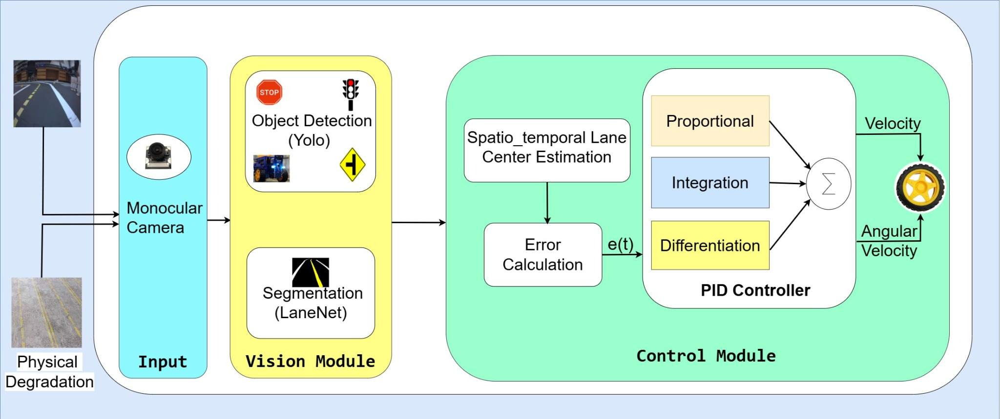
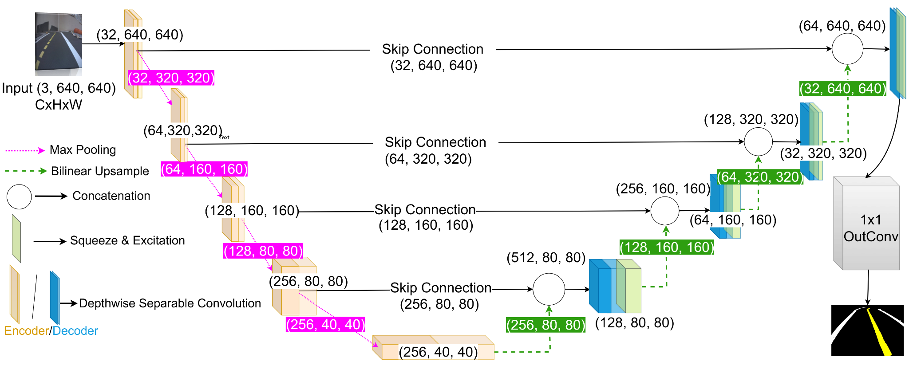
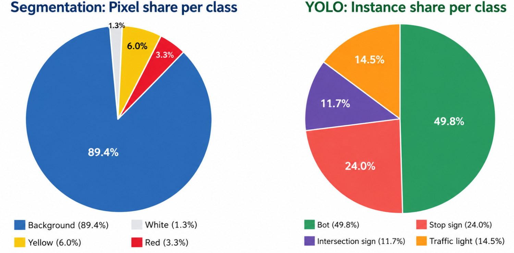
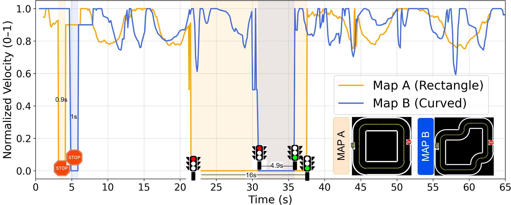
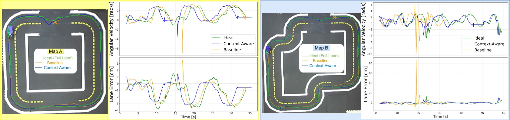

# Towards Context-Aware Autonomous Driving in Degraded Urban Environments using LaneNet

This repository contains the **perception–control implementation** for the accepted paper:

> **Towards Context-Aware Autonomous Driving in Degraded Urban Environments using LaneNet**  
> **Maher Al Islam and Amr S. El-Wakeel**  
> *2026 IEEE International Conference on Smart Mobility (SM)*, 2026.

## Overview

The proposed framework combines **LaneNet** (lightweight four-class lane segmentation), **YOLOv8n** semantic object detection, **spatio-temporal lane-center estimation**, and **PID-based vehicle control**. It is evaluated on physical Duckietown tracks with partially missing lane markings. The Duckiebot streams camera frames to a GPU workstation through TCP; the workstation estimates lane position and semantic cues, computes linear/angular velocity, and sends commands back to the robot.

The model's main technical features are depthwise separable convolution, squeeze-and-excitation (SE) attention, and **Focal + Dice** training for class-imbalanced lane markings. The context-aware estimator uses **near-/far-field spatial validation** with a short-term history of **eight valid lane-center estimates** for fallback. YOLOv8n provides stop-sign, traffic-light, and obstacle cues.

**Scope:** This is the *context-aware degraded-lane* paper. Adversarial examples, FGSM/PGD, packet loss, and network impairment are **not included** here; they belong to the [separate adversarial robustness paper repository](https://github.com/ICPS-LAB-WVU/Adversarial-Robustness-Analysis-of-Cloud-Assisted-Autonomous-Driving-Systems).

## Perception and control architecture



*Figure 1. Vision, context-aware lane-center estimation and feedback control pipeline.*



*Figure 2. Lightweight LaneNet encoder–decoder architecture.*

The inference pipeline processes **640 × 640 RGB frames**:

1. **LaneNet:** Produces a four-class segmentation mask (background, red, white, yellow).
2. **Spatial validation:** Checks near and far ROIs for white and yellow lane observations.
3. **Temporal fallback:** Uses the mean of the last eight valid center estimates when current markings are unavailable.
4. **YOLOv8n:** Detects robots, stop signs, intersection signs, and traffic lights.
5. **PID/FSM:** Calculates angular and linear velocity and obeys the observed stop/traffic-light cues.

## Repository layout

```text
.
├── README.md
├── gpu_server.py                     # TCP server; GPU perception/control
├── perception_control.py             # LaneNet/YOLO inference, PID and traffic-rule FSM
├── lane_center_estimation.py          # Two-ROI validation and N=8 memory fallback
├── visualization.py                  # Segmentation and detections overlay
├── class_labels.py                   # YOLO class mappings
├── configs/lanenet_focal_dice_640.yaml
├── requirements-server.txt
├── Dockerfile                         # Duckiebot-side Duckietown Docker image
├── launchers/default.sh              # `dts devel` launcher
├── packages/my_package/              # ROS Duckiebot TCP camera client
│   └── src/vehicle_client.py
├── figures/                           # Figures supplied with the paper
├── tests/test_lane_center_estimation.py
└── training/lane-segmentation/        # Upstream training repository (Git submodule)
```

The LaneNet **training and evaluation code** is maintained in [ICPS-LAB-WVU/Duckietown-Lane-Segmentation](https://github.com/ICPS-LAB-WVU/Duckietown-Lane-Segmentation). It is included as a Git submodule when setting up the published repository, avoiding a divergent copy of the model/loss/trainer code. The present repository adds the paper-specific **context-aware driving** implementation.

**For the first repository upload only**, attach the upstream training project before committing:

```bash
git submodule add https://github.com/ICPS-LAB-WVU/Duckietown-Lane-Segmentation.git training/lane-segmentation
git -C training/lane-segmentation checkout 04b87b124a2b6d5e041c49cdf61a3647b90b7160
git add .gitmodules training/lane-segmentation
```

The Git submodule records that inspected training revision; future users retrieve it using `git clone --recurse-submodules`.

## Dataset and LaneNet training

The paper uses **4,950 image–mask pairs** for segmentation and **4,886 annotated RGB images** for YOLOv8n semantic detection. Four pixel classes are used: **0 = background, 1 = red, 2 = white, 3 = yellow**.



*Figure 5. Severe segmentation class imbalance motivates the Focal + Dice training loss.*

Install the training module and follow its [dataset instructions](https://github.com/ICPS-LAB-WVU/Duckietown-Lane-Segmentation#1-download-the-dataset). The dataset is distributed separately and is **not committed to this repository**.

```bash
# If cloning this repository after publication:
git clone --recurse-submodules \
  https://github.com/ICPS-LAB-WVU/Towards-Context-Aware-Autonomous-Driving-in-Degraded-Urban-Environments-using-LaneNet.git
cd Towards-Context-Aware-Autonomous-Driving-in-Degraded-Urban-Environments-using-LaneNet

# Install PyTorch compatible with your local CUDA configuration first.
python3 -m pip install -r requirements-server.txt
python3 -m pip install -e training/lane-segmentation

# Extract the Duckietown segmentation dataset under:
# training/lane-segmentation/datasets/trainTRACKimg/
# training/lane-segmentation/datasets/trainTRACKmask/

python3 training/lane-segmentation/scripts/train.py \
  --model-config training/lane-segmentation/configs/model/depthwise_se.yaml \
  --train-config configs/lanenet_focal_dice_640.yaml
```

The supplied training configuration follows the paper's **640 × 640**, depthwise/SE and **Focal + Dice** design; it is a clean runnable configuration for the released dataset, not a claim that every historical training setting was recovered. The saved model can be found at:

```text
training/lane-segmentation/outputs/depthwise_se/lanenet_focal_dice_640/best_checkpoint.pth
```

Use the matching architecture and checkpoint; **the older vanilla U-Net `segment_model_old.pth` from the cloud-assisted adversarial repository is not a LaneNet checkpoint and must not be substituted**. The YOLOv8n detector also requires the matching trained `yolo.pt` checkpoint (obtain it from the associated lab resources or your original training run).

## Run the cloud-assisted driving system

### GPU workstation

```bash
export YOLO_WEIGHTS=/path/to/yolo.pt
export LANENET_WEIGHTS=training/lane-segmentation/outputs/depthwise_se/lanenet_focal_dice_640/best_checkpoint.pth
export GPU_SERVER_PORT=5001

python3 gpu_server.py --show-gui
# Without GUI: python3 gpu_server.py
```

The workstation loads the upstream `ConfigurableUNet` with **depthwise convolutions + decoder SE blocks** and performs class-index segmentation, not thresholding the raw logits. It maintains an independent context/memory and control state for each Duckiebot.

### Duckiebot (Docker / `dts devel`)

Run from the project root with Duckietown Shell:

```bash
dts devel build -H ruks007 -f

export GPU_SERVER_IP=<gpu-workstation-ip>
export GPU_SERVER_PORT=5001
export GPU_FRAME_RATE=15

dts devel run -H ruks007 -f -- \
  -e GPU_SERVER_IP \
  -e GPU_SERVER_PORT \
  -e GPU_FRAME_RATE
```

The `launchers/default.sh` entry point runs `rosrun my_package vehicle_client.py` **inside the Duckiebot container**. The client subscribes to the compressed camera stream, sends JPEG frames with frame IDs over TCP, and publishes the returned `v` and `omega` commands to `car_cmd_switch_node`. Test with wheels off the ground before driving on the track.

**Implementation note:** The paper reports PID gains **Kp = 0.25, Ki = 0.01, Kd = 0.05**, velocity decay constant **κ = 20** and memory length **N = 8**. Values are exposed as environment variables for deployment. Exact near/far ROI pixel boundaries, per-run calibration, and complete original checkpoints were not specified in the manuscript; they require validation against the experiment setup. The released controller follows the reported method, but is not asserted to be byte-identical to the historical lab implementation.

## Published results

The LaneNet variant using **depthwise separable convolutions, SE attention and Focal + Dice** achieved **0.94 mIoU**, **0.95 Boundary F1**, and approximately **0.52 million parameters**, versus **4.32 million parameters** for the vanilla U-Net baseline (Table II of the paper).



*Figure 6. Reactive velocity profiles and stopping behavior on rectangular and curved Duckietown maps.*



*Figure 7. Ideal lane visibility, degraded baseline, and the proposed context-aware estimator on two maps.*

The paper reports the following lane error metrics (Table III):

| Map | Condition | MSE (cm²) | RMSE (cm) | MAE (cm) |
| --- | --- | ---: | ---: | ---: |
| A (rectangle) | Degraded baseline | 3.28 | 1.81 | 1.37 |
| A (rectangle) | Spatio-temporal (proposed) | **2.69** | **1.64** | **1.20** |
| B (curved) | Degraded baseline | 54.10 | 7.36 | 2.58 |
| B (curved) | Spatio-temporal (proposed) | **2.87** | **1.69** | **1.29** |

These are **published paper values**, not metrics generated by running this repository in the current session. The paper also presents comparisons with ideal full-lane conditions.

## Citation

If you use the framework or refer to the results, please cite:

```bibtex
@INPROCEEDINGS{11614147,
  author={Al Islam, Maher and El-Wakeel, Amr S.},
  booktitle={2026 International Conference on Smart Mobility (SM)}, 
  title={Towards Context-Aware Autonomous Driving in Degraded Urban Environments using LaneNet}, 
  year={2026},
  volume={},
  number={},
  pages={1-8},
  doi={10.1109/SM69703.2026.11614147}}
```

No DOI is listed here until it can be verified for this particular paper.

## Authors and acknowledgment

**Maher Al Islam** and **Amr S. El-Wakeel**  
Lane Department of Computer Science and Electrical Engineering, West Virginia University.

Research was partially supported by **DARPA AI-CRAFT, award AWD16069**.
